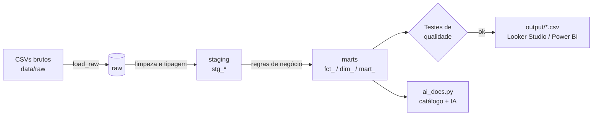

# 🛒 Mini Analytics Engineering Pipeline

> Pipeline **ELT** completo de e-commerce, com **camadas de modelagem (raw → staging → marts)**, **testes de qualidade de dados**, **documentação automática com apoio de IA generativa** e **CI no GitHub Actions**.
> Roda 100% local com Python + SQL (DuckDB), usando uma estrutura **idêntica à de projetos dbt / Dataform no BigQuery**.

---

## 🎯 Objetivo

Demonstrar, em um projeto pequeno e reproduzível, as práticas do dia a dia de um time de **Analytics Engineering**:

| Prática | Onde aparece neste projeto |
|---|---|
| SQL de transformação e modelagem dimensional | `models/staging/*.sql`, `models/marts/*.sql` |
| ELT (carregar bruto, transformar dentro do banco) | `src/pipeline.py` → `load_raw()` + `run_models()` |
| Python para automação | `src/pipeline.py`, `src/generate_data.py` |
| Qualidade de dados e testes | `models/schema.yml` + `tests/*.sql` (32 testes) |
| Documentação técnica | `schema.yml` + `docs/data_catalog.md` |
| IA Generativa e engenharia de prompts | `src/ai_docs.py` (flag `--ai`) |
| Git e versionamento / CI | `.github/workflows/ci.yml` |
| Visualização (Looker Studio / Power BI) | CSVs prontos em `output/` |

---

## 🧭 Arquitetura



### Camadas

| Camada | Papel | Modelos |
|---|---|---|
| **raw** | Cópia fiel da origem, tudo como texto. Nada é corrigido aqui. | `customers`, `orders`, `order_items`, `products` |
| **staging** | Limpeza, tipagem, padronização e deduplicação. 1 modelo por tabela de origem. | `stg_customers`, `stg_orders`, `stg_order_items`, `stg_products` |
| **marts** | Modelos prontos para o negócio (fatos, dimensões e indicadores). | `fct_orders`, `dim_customers`, `mart_monthly_revenue`, `mart_category_performance`, `mart_customer_rfm` |

### Problemas de qualidade injetados (e tratados)

Os dados são gerados **propositalmente sujos** para que a limpeza seja real:

- 15 clientes e 25 pedidos **duplicados** → `row_number()` na staging.
- E-mails em caixa mista e nomes com espaços → `lower()`, `trim()`.
- Estados vazios ou minúsculos → `upper()`, `nullif()`, `coalesce()` (`'NA'`).
- Status inconsistentes (`cancelled`, `CANCELED`, `Delivered `) → padronizados em 3 valores.
- Itens com quantidade `0` ou negativa → filtrados.

---

## 🚀 Como executar

```bash
# 1. Ambiente
python -m venv .venv 

python venv\Scripts\activate 

pip install -r requirements.txt

# 2. Gerar dados brutos
python -m src.generate_data

# 3. Rodar o pipeline (carga → transformação → testes → export)
python -m src.pipeline

# 4. Testes unitários do framework
python -m pytest -q

# 5. Catálogo de dados
python -m src.ai_docs                 # offline
export ANTHROPIC_API_KEY="sua-chave-aqui" 
python -m src.ai_docs --ai # se quiser com resumos de negócio gerados por IA
```

Saída esperada (resumo):

```
Resultado: 32 passaram, 0 falharam
Receita total: R$ 9,450,561.02 em 2,556 pedidos
Categoria líder: Eletrônicos
```

---

## 🧩 Explicação dos componentes

### `src/generate_data.py`
Gera 4 CSVs sintéticos com **semente fixa** (resultados reproduzíveis) e defeitos intencionais.

### `src/pipeline.py` — o "mini dbt"
| Função | O que faz |
|---|---|
| `discover_models()` | Lê os `.sql`, usa o nome da pasta como *schema* e extrai dependências via `{{ ref() }}`. |
| `execution_order()` | Ordenação topológica (`graphlib`) do DAG: cada modelo roda depois de suas dependências. |
| `compile_sql()` | Substitui `{{ ref('x') }}` e `{{ source('raw','y') }}` pelos nomes reais das tabelas. |
| `load_raw()` | **E/L**: carrega CSVs no schema `raw` sem transformar. |
| `run_models()` | **T**: executa `create or replace table schema.modelo as <select>`. |
| `run_tests()` | Executa testes genéricos (`schema.yml`) e singulares (`tests/*.sql`). |
| `export_marts()` | Exporta os marts em CSV para ferramentas de BI. |
| `main()` | Orquestra tudo e devolve **exit code 1** se algum teste falhar (quebra o CI). |

### Modelagem (marts)
- **`fct_orders`**: fato com 1 linha por pedido; flag `is_revenue` (não cancelado).
- **`dim_customers`**: dimensão com pedidos, receita acumulada, primeira/última compra.
- **`mart_monthly_revenue`**: receita, ticket médio e crescimento MoM (`lag()`).
- **`mart_category_performance`**: receita e unidades por categoria.
- **`mart_customer_rfm`**: segmentação RFM com `ntile(4)` → *Champions*, *Promising*, *At Risk*, *Hibernating*.

### Testes de qualidade
- **Genéricos** (`schema.yml`): `not_null`, `unique`, `accepted_values`, `relationships` (integridade referencial).
- **Singulares** (`tests/*.sql`): regras de negócio e **reconciliação** (a receita do mart precisa bater com a da fato).
- Convenção: o SQL retorna as linhas que **violam** a regra; zero linhas = teste aprovado.

### `src/ai_docs.py` — IA generativa com prompt estruturado
Gera `docs/data_catalog.md` lendo `schema.yml` e o catálogo real do banco. Com `--ai`, envia um prompt com **papel + contexto + tarefa + formato + restrições** ("use somente informações do contexto") para reduzir alucinação e produzir resumos de negócio por tabela.

---

## ☁️ Como isso se traduz para GCP / BigQuery

| Aqui (local) | Em produção (GCP) |
|---|---|
| DuckDB | BigQuery |
| `data/raw/*.csv` | Cloud Storage → tabelas externas/raw no BigQuery |
| `models/**/*.sql` + `{{ ref() }}` | Modelos **dbt** ou **Dataform** (mesma sintaxe de `ref`/`source`) |
| `schema.yml` + `tests/` | Testes e *assertions* do dbt / Dataform |
| `pipeline.py` | `dbt run && dbt test` ou workflows do Dataform |
| `output/*.csv` | Conexão direta do **Looker Studio** ao BigQuery |
| GitHub Actions | CI/CD com Cloud Build / GitHub Actions |

Funções de SQL a adaptar: `date_diff('day', a, b)` → `DATE_DIFF(b, a, DAY)`, `date_trunc('month', d)` → `DATE_TRUNC(d, MONTH)`; `ntile`, `lag`, `row_number` são iguais.

---

## 🗺️ Próximos passos

- [ ] Migrar os modelos para dbt/Dataform apontando para BigQuery.
- [ ] Particionamento/clustering e modelos incrementais.
- [ ] Dashboard no Looker Studio sobre `mart_monthly_revenue` e `mart_customer_rfm`.
- [ ] Testes de frescor (freshness) e alertas.

---

## 📁 Estrutura

```
.
├── data/raw/                # CSVs gerados (ignorado no git)
├── models/
│   ├── staging/             # stg_*.sql
│   ├── marts/               # fct_, dim_, mart_*.sql
│   └── schema.yml           # documentação + testes
├── tests/                   # testes SQL singulares
├── src/
│   ├── generate_data.py
│   ├── pipeline.py
│   └── ai_docs.py
├── unit_tests/              # pytest
├── docs/data_catalog.md     # catálogo gerado
├── .github/workflows/ci.yml
└── README.md
```